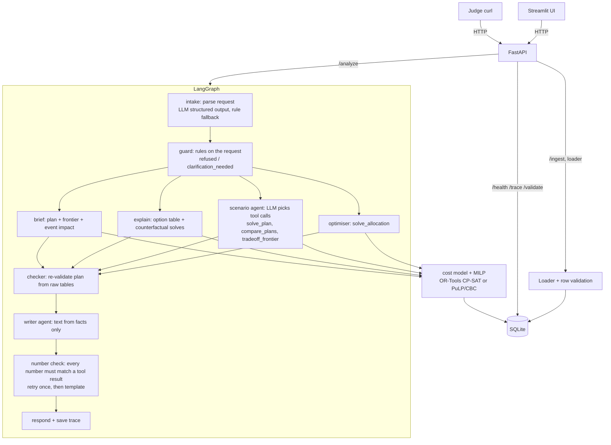

# Multi-Plant Order Allocation with Cost and Carbon

HCLTech Future Ready AI Engineer Hackathon. A solver allocates orders to three plants; an LLM reads
requests, chooses what-if solver runs and writes the text. Every number comes from code.

## Architecture



| Step | Kind | Why |
|---|---|---|
| intake | LLM (structured JSON) with a rule parser fallback | Free text needs reading; the schema stops it from inventing numbers |
| guard | code | Refusals and clarifications must be the same every time |
| optimiser, checker | fixed steps | Deterministic. An agent here would only add risk |
| scenario agent | LLM + tools, max 4 calls | What-if questions vary and combine; the LLM chooses which solver runs to make |
| writer | LLM, checked | Text for people, from the facts JSON only |
| number check | code | Rejects any number that is not a tool result |

## Run it

```bash
cp .env.example .env            # MOCK_LLM=true works with no key
docker compose up --build       # API on :8000, UI on :8501, data pack seeded on first start
```

Without Docker (Python 3.12):

```bash
pip install -r requirements.txt
python -m src.loader data/                 # load + validate the pack (prints the Section 4.5 report)
uvicorn src.api:app --port 8000
streamlit run ui/app.py                    # API_URL defaults to http://localhost:8000
pytest -q                                  # unit tests on hand-checked datasets
python -m eval.run_eval                    # 25 eval cases + comparisons -> eval/report.md
```

Switch LLM: set `MOCK_LLM=false`, `LLM_PROVIDER` (gemini | anthropic | openai | ollama), `LLM_MODEL` and the key.

## API (Section 6)

```bash
curl -s localhost:8000/health
curl -s -X POST localhost:8000/analyze -H 'Content-Type: application/json' \
     -d '{"request": "Allocate this week'"'"'s orders."}'
curl -s -X POST localhost:8000/analyze -H 'Content-Type: application/json' \
     -d '{"request": "What does a 10% carbon cut cost?"}'
curl -s -X POST localhost:8000/analyze -H 'Content-Type: application/json' \
     -d '{"request": "Plant B loses 30% capacity. Re-plan."}'
curl -s -X POST localhost:8000/analyze -H 'Content-Type: application/json' \
     -d '{"request": "Re-plan", "weights": {"cost": 0.6, "carbon": 0.4}, "scenario": {"plant": "B", "capacity_loss_pct": 30, "from_date": "2026-10-12", "to_date": "2026-10-25"}}'
curl -s -X POST localhost:8000/analyze -H 'Content-Type: application/json' \
     -d '{"request": "Why was order 77 built in Plant C?"}'
curl -s -X POST localhost:8000/analyze -H 'Content-Type: application/json' \
     -d '{"request": "Write the brief for the leadership team."}'
curl -s -X POST localhost:8000/ingest -F file=@data/capacity_events.csv -F 'meta={"table":"capacity_events"}'
curl -s localhost:8000/trace/<run_id>
curl -s localhost:8000/validate
```

`/ingest` accepts the table name as form field `table`, `table_name`, or JSON `meta`. Orders, plants and
transport tables are **replaced** by a new upload (a new dataset); capacity events are **added**
(same `event_id` replaces). Loader CLI for judge data: `python -m src.loader <folder>` or
`python -m src.loader --file x.csv --table orders`.

Response extras beyond Section 6.1: `flagged_orders` (late/unserved with the closest option),
`comparison` and `moved_orders` (scenarios), `explanation`, `unserved`, `solver`, `number_check`,
`recommendations` (action, rationale, evidence_refs, confidence, estimated_impact, requires_approval).

## The model

For every order x eligible plant x production week, `src/cost_model.py` computes:

```
landed cost = qty x (unit_cost + energy_kwh x energy_price + transport) x (1 + duty_pct/100)
carbon kg   = qty x (energy_kwh x carbon_kg_per_kwh[week] + transport_carbon_per_unit)
arrival     = planning_start + 7*week + SHIP_OFFSET_DAYS + transit_days ;  late = arrival > due
```

`src/solver.py` picks one option per order (binary `x[o,p,w]`), or flags it unserved (`u[o]`):

- each order once: `sum x + u = 1`; weekly capacity per plant after capacity events (pro-rated by days);
- objective `w_cost*Cost/C0 + w_carbon*Carbon/E0 + w_late*Lateness/N + 10*Unserved (+ churn when re-planning)`,
  with C0/E0 the sum of each order's cheapest/greenest option so the weights are unit-free;
- trade-off: epsilon-constraint, minimise cost s.t. carbon <= (1 - k%) x carbon of the cheapest plan;
- re-plan: same model with the reduced capacity plus a churn penalty (0.1/N per order moved off its
  baseline plant), so only the orders that must move do move;
- `cheapest on-time plan`: late options removed; orders with no on-time option become `infeasible`
  with their closest option.

Back-ends: OR-Tools CP-SAT (default, deterministic budget so the same input gives the same plan) and
PuLP/CBC (`SOLVER=cbc`). Both are compared in `eval/report.md`.

## Default weights: 0.7 cost / 0.3 carbon

Defended with the solver's own numbers, not by assertion. The weight sweep in `eval/report.md`
(synthetic pack) gives:

| carbon weight | cost | carbon t | late |
|---|---|---|---|
| 0.0 | 682,034 | 102.6 | 20 |
| 0.2 | 699,944 | 85.0 | 21 |
| 0.3 (default) | 703,329 | 83.1 | 22 |
| 0.6 | 706,575 | 77.0 | 25 |
| 1.0 | 710,364 | 72.5 | 31 |

Moving from 0 to 0.3 removes 64.8% of the carbon that can be removed at all, for 3.12% more cost.
Going on to 1.0 costs only 1.0% more but adds 9 late orders: past 0.3 the extra carbon cut is paid
for in customer delivery dates, not money. So 0.3 is the point before the trade-off turns against the
customer. Re-run `python -m eval.run_eval` on the official pack and quote the numbers it prints.

Lateness has its own weight (1.0): a late order costs about as much as one average order's normalised
cost plus 1/7 per late day, so the solver accepts lateness only when capacity forces it.

## Edge cases (Section 4.4) and where they are handled

| Edge case | Handling |
|---|---|
| Cheapest plan misses a date | Lateness in the objective; `cheapest on-time` forbids late options; checker recomputes arrival |
| Order only one plant can make | Eligibility from `plants.csv` (plant x product rows); force to another plant is `refused` |
| Duty makes cheapest plant expensive | Duty is part of landed cost per destination |
| Low-carbon plant with little capacity | Weekly capacity constraint; overflow spills to the next best plant |
| Capacity loss makes orders impossible | Late or unserved orders are flagged with the closest option; `infeasible` when orders cannot be served |
| Carbon intensity changes by week | Optional `week` column in `plants.csv`; options are per production week |

## Assumptions (also returned in every response)

- Planning starts `PLANNING_START` (Monday). **Set it to the first Monday of the official pack's horizon**:
  the validator fails "due dates after planning start" if it is wrong. An order built in week w ships on day 4 of that week.
- Duty is charged on production + energy + transport value.
- `weekly_capacity` is shared across a plant's products when all its rows have the same value, otherwise per product (`CAPACITY_SCOPE`).
- No energy price column in Annex B: an optional `energy_price_per_kwh` column is used when present, otherwise energy cost is taken as included in `unit_cost`.
- `capacity_loss_pct` may be 30 or 0.30; both mean 30%. A capacity change with no dates applies to the whole horizon.
- Orders are not split across plants or weeks.

## Limitations

- Costs, transit days and duties are constant over the horizon; one transport mode per route.
- The solver stops at a fixed work budget; responses report the proven optimality gap (about 1-2% on the pack).
- The trade-off and brief run one solve per carbon cut (about 15-25 s on a 2-core machine; cached per data version).
- The rule-based parser (mock mode and fallback) covers the phrasings in the guide and common variants, not arbitrary language.

## Evaluation

`python -m eval.run_eval` runs 25 cases (3+ cheapest-is-late, 4 capacity loss, 2 infeasible, 4 weight
settings, 2 hallucination attempts, refusals, clarifications, explain, trade-off) and writes
`eval/report.md`: pass rate, plan validity, brief faithfulness, latency p50/p95, LLM calls and tokens,
re-plan quality, solver vs greedy baseline, CP-SAT vs CBC, and the weight sweep.

## Repository map

```
src/config.py       settings from .env          src/cost_model.py  options: cost, carbon, arrival
src/models.py       Pydantic rows + API          src/solver.py      MILP, frontier, compare, greedy
src/loader.py       CSV ingest + CLI             src/checker.py     independent plan validation
src/validator.py    Section 4.5 data checks      src/planning.py    cache per data version
src/intent.py       request parsing              src/graph.py       LangGraph pipeline + trace
src/agents/         scenario agent, writer       src/guardrails.py  number check
src/api.py          FastAPI                      ui/app.py          Streamlit
scripts/generate_data.py  data generator         eval/              cases, datasets, runner, report
```

## AI usage disclosure

Parts of this code were drafted with an AI coding assistant (Claude). Every module was read, run and
tested by the team: `pytest` (hand-worked expected answers), the evaluation suite, and manual API calls.
*(Team: edit this paragraph to describe exactly who used what, and how you verified it.)*

## Team contribution

| Member | Built | Also reviewed |
|---|---|---|
| Dev 1 | loader, validator, API, data generator | |
| Dev 2 | cost model, solver, checker, frontier | |
| Dev 3 | LangGraph, intent, scenario agent, writer, number check | |
| Dev 4 | UI, eval suite, Docker, README | |
